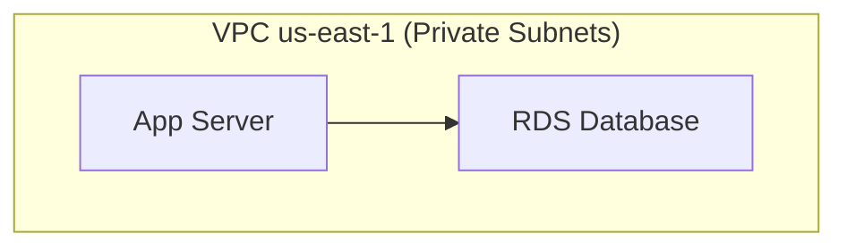

# Mermaid Diagram Patterns & Obsidian Embed Standards

Guidelines for authoring clear, readable Mermaid diagrams and integrating them cleanly inside Markdown notes.

## 1. Clean Mermaid Authoring

### Node Labels & HTML Escaping
- In flowcharts, quote node labels containing parentheses, colons, or line breaks:
  `Node["My Service<br/>(Sub-detail)"]`
- Use semantic arrows:
  - `-->` Solid line with arrow (direct synchronous call or flow)
  - `-.->` Dotted line with arrow (asynchronous, replication, or background trigger)
  - `---|label|` Labeled association without direction

### Flowchart Directions
- `flowchart TD` (Top-down): Best for decision trees, hierarchical structures, network tiers.
- `flowchart LR` (Left-to-right): Best for timelines, stages, multi-pass pipelines, and data ingress pipelines.

### Subgraphs for Boundaries
Always use subgraphs to convey security, VPC, or organisational boundaries:


---

## 2. The Obsidian Dual-View Standard (Canvas + Mermaid Backup)

When providing an interactive Canvas representation alongside an offline Mermaid diagram, **NEVER use HTML `<details>`/`<summary>` tags inside blockquotes**. It breaks Obsidian's markdown parser.

### Standard Dual-View Format:

````markdown
> [!CANVAS] **Interactive Canvas View**
> 🗺️ **[Open Interactive Architecture Canvas ↗](path/to/diagram.canvas)** `[[path/to/diagram.canvas|Open in Canvas Tab]]`

> [!NOTE]- 📊 Mermaid Diagram Backup (Click to expand)
> ```mermaid
> flowchart TD
>     A --> B
> ```
````

**Key Rules:**
1. The canvas link provides both standard POSIX markdown link `[label](path.canvas)` (for CLI / OKF / GitHub) and native Obsidian wikilink `[[path.canvas|Open in Canvas Tab]]`.
2. The `-` in `[!NOTE]-` instructs Obsidian to render the callout collapsed by default.
3. Expanding the callout displays the fully rendered Mermaid diagram natively with zero broken HTML tags.
